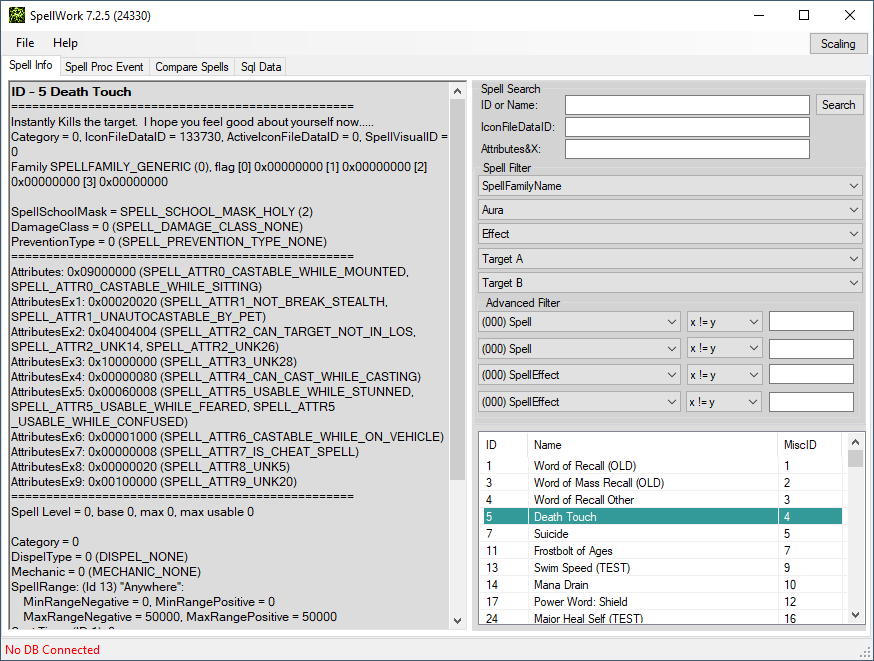

# SpellWork

[](https://github.com/HavenWoW/SpellWork/actions/workflows/ci.yml)
[](https://scan.coverity.com/projects/spellwork)
[](LICENSE)

SpellWork browses and displays information about World of Warcraft spells: the
decoded spell record, its effects, auras, targeting, scaling, proc conditions
and visual chain, read straight from client DB2 data and — optionally — a
TrinityCore world database.



## Client support

This repository tracks the **8.x** line. It parses **8.3.7 (build 35662)**
client data and reports itself as `SpellWork 8.3.0 (34220)`.

DB2 structures are version-specific: pointing it at data from another
expansion will fail layout verification rather than silently misread fields.
MCP servers for 5.4.8, 5.5.4 and CoA 3.3.5a live on this repository's
`5.4.8`, `5.5.4` and `coa` branches (see [Register with Claude Code](#register-with-claude-code)).
For other client versions, see the branches on
[upstream TrinityCore/SpellWork](https://github.com/TrinityCore/SpellWork).

## What's in here

| Project | Target | Purpose |
| --- | --- | --- |
| `SpellWork` | net48 | WinForms desktop UI |
| `SpellWork.Core` | netstandard2.0 | DB2/GameTable loading, world DB access, the spell model, rendering and visual-chain resolution |
| `SpellWork.Mcp` | net9.0 | Read-only [Model Context Protocol](docs/mcp-server.md) server exposing the same data to an AI agent |
| `SpellWork.Core.Tests`, `SpellWork.Mcp.Tests` | net9.0 | xUnit suites, including golden-output rendering and DB2 layout verification |

The rendering logic lives in `Core`, not in the UI, so the desktop app, the MCP
server and the golden tests all produce the same spell text from the same code.

## Getting the app

Download `SpellWork.zip` from the [latest release](https://github.com/HavenWoW/SpellWork/releases),
or grab the artifact from the most recent
[CI run](https://github.com/HavenWoW/SpellWork/actions/workflows/ci.yml).

### Client data

Client data is **not** redistributable and is not included here. Extract it
yourself with TrinityCore's extractors and point SpellWork at the result:

- **DBC path** — `<emulator-build-dir>/ClientData/dbc` (contains a locale
  subdirectory such as `enUS`)
- **GameTables path** — `<emulator-build-dir>/ClientData/gt`

Run `SpellWork.exe` and set both under **Settings**. A world database
connection is optional; without it, the DB-backed views report as unavailable
and everything else still works.

## Building from source

Requires Visual Studio 2022 (or the Build Tools) with the **.NET Framework 4.8
targeting pack** for the WinForms project, plus the **.NET 9 SDK** for `Core`,
`Mcp` and the tests.

```
msbuild SpellWork.sln -t:Restore
msbuild SpellWork.sln -p:Configuration=Release
dotnet test SpellWork.sln -c Release --no-build
```

`dotnet build` alone is not enough: `SpellWork.csproj` is a legacy-format net48
WinForms project and needs full MSBuild.

Tests that require real client data skip themselves when none is present, so a
clean checkout reports a large skip count rather than failures. Only the
data-independent tests — SQL guarding, flag decoding, JSON shape, layout
constants, MCP tool contracts — run everywhere.

`DBFileReaderLib.dll` is vendored under `packages/` because it is not published
on NuGet and every project references it by `HintPath`. It is tracked
deliberately, past the `**/packages/*` ignore rule.

## MCP server

`SpellWork.Mcp` exposes this data to an AI agent over the Model Context
Protocol, read-only, as fourteen tools. See
**[docs/mcp-server.md](docs/mcp-server.md)** for build, registration and
configuration.

> **Security:** `query_world_db` executes SQL composed by the agent. The server
> rejects anything that is not a single `SELECT`, but that parser is a guard,
> not a guarantee — connect as a MySQL user with only `SELECT` granted.

### Register with Claude Code

Every [release from v1.1.0 on](https://github.com/HavenWoW/SpellWork/releases/latest)
ships one MCP server per supported client version. Pick the one that matches
**your client data**; you can register several side by side under different
names.

| Archive | Client data | Source branch | Tools | Suggested name |
| --- | --- | --- | --- | --- |
| `SpellWork.Mcp-837.zip` | 8.3.7 (BfA) DB2 | [`main`](https://github.com/HavenWoW/SpellWork/tree/main) | 14 | `spellwork-837` |
| `SpellWork.Mcp-548.zip` | 5.4.8 (18414) DBC + DB2 | [`5.4.8`](https://github.com/HavenWoW/SpellWork/tree/5.4.8) | 14 | `spellwork-548` |
| `SpellWork.Mcp-554.zip` | 5.5.4 (70449) DB2 | [`5.5.4`](https://github.com/HavenWoW/SpellWork/tree/5.5.4) | 3 | `spellwork-554` |
| `SpellWork.Mcp-coa.zip` | CoA 3.3.5a (12340) DBC | [`coa`](https://github.com/HavenWoW/SpellWork/tree/coa) | 14 | `spellwork-coa` |

1. **Prerequisites.** The .NET 9 runtime (`dotnet --list-runtimes` lists
   `Microsoft.NETCore.App 9.x`), Claude Code, and your extracted client data.
2. **Unzip** the archive to a folder that will stay put, e.g.
   `C:/Tools/spellwork-837/`. Claude Code starts the server from there every
   session.
3. **Register** it for every project (`--scope user`). Use forward slashes in
   paths.

   PowerShell — quote the `'--'`, a bare `--` is swallowed by the npm `claude`
   shim:

   ```powershell
   claude mcp add --scope user spellwork-837 `
     -e SPELLWORK_DBC_PATH=D:/ClientData/dbc `
     -e SPELLWORK_GT_PATH=D:/ClientData/gt `
     -e SPELLWORK_LOCALE=enUS `
     '--' dotnet C:/Tools/spellwork-837/SpellWork.Mcp.dll
   ```

   bash / zsh / Git Bash:

   ```bash
   claude mcp add --scope user spellwork-837 \
     -e SPELLWORK_DBC_PATH=/data/ClientData/dbc \
     -e SPELLWORK_GT_PATH=/data/ClientData/gt \
     -e SPELLWORK_LOCALE=enUS \
     -- dotnet /opt/spellwork-837/SpellWork.Mcp.dll
   ```

   cmd.exe: as bash, with `^` instead of `\` at line ends.

   Settings per variant:

   | Variant | Required | Optional |
   | --- | --- | --- |
   | 837 | `SPELLWORK_DBC_PATH` (DB2 `dbc` folder) | `SPELLWORK_GT_PATH`, `SPELLWORK_HOTFIX_CACHE`, `SPELLWORK_LOCALE`, world DB |
   | 548 | `SPELLWORK_DBC_PATH` (`dbc` folder) | `SPELLWORK_DB2_PATH`, `SPELLWORK_LOCALE`, world DB |
   | 554 | `SPELLWORK_DBC_PATH` (DB2 folder) | `SPELLWORK_LOCALE`, `SPELLWORK_DEFS_PATH`, `SPELLWORK_BUILD` |
   | coa | `SPELLWORK_DBC_PATH` (`dbc` folder; CoA server checkout: `env/dist/data/dbc`) | `SPELLWORK_LOCALE`, world DB |

   Optional world database (837, 548, coa): add
   `-e SPELLWORK_MYSQL_HOST=127.0.0.1 -e SPELLWORK_MYSQL_PORT=3306 -e SPELLWORK_MYSQL_USER=<read-only user> -e SPELLWORK_MYSQL_PASS=<password> -e SPELLWORK_MYSQL_WORLD_DB=<world schema>`.
4. **Verify.** `claude mcp list` shows the server as `✔ Connected`; in a
   session, `/mcp` lists it, and its `server_info` tool reports the client
   build and no `layoutMismatches`.

Project-scoped instead: put the same command in a `.mcp.json`
(`"command": "dotnet"`, `"args": ["<path>/SpellWork.Mcp.dll"]`, `"env": {…}`).
Remove with `claude mcp remove <name> --scope user`; update by unzipping the new
archive over the old folder and restarting Claude Code. More troubleshooting is
in the [v1.1.0 release notes](https://github.com/HavenWoW/SpellWork/releases/tag/v1.1.0)
and each branch's `docs/mcp-server.md`.

## Static analysis

[Coverity Scan project 33228](https://scan.coverity.com/projects/spellwork)
analyses this codebase. `.github/workflows/coverity.yml` builds under
`cov-build` and submits, weekly and on demand — not per push, because Coverity
rate-limits submissions.

The workflow skips itself unless `COVERITY_SCAN_TOKEN` and
`COVERITY_SCAN_EMAIL` exist as repository secrets. Both come from the project's
Coverity dashboard (*Project Settings* for the token, *Submit Build* for the
exact `project=` value the upload expects).

## History

SpellWork is a tool originally created by Chestr (also known as DiSlord); the
C# rebuild is [TrinityCore/SpellWork](https://github.com/TrinityCore/SpellWork),
which this repository is derived from.

Thanks to:

- Chestr — for the idea and the released source of the original spell_work
- TOM_RUS — for code samples
- Shauren — for updating it for TrinityCore

## License

[MIT](LICENSE). Copyright (c) 2011-2017 TrinityCore; unattributed 2010-2012
Chestr, LordJZ, Konctantin.
